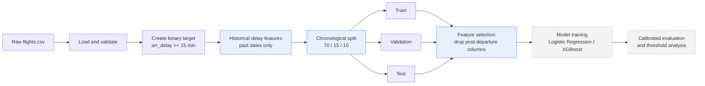
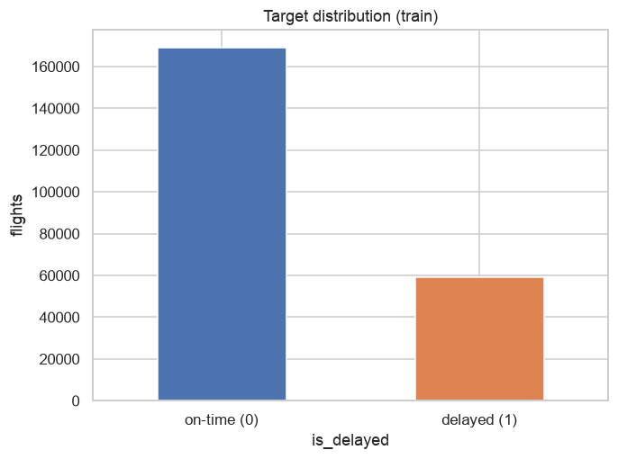
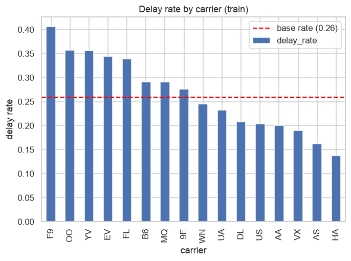
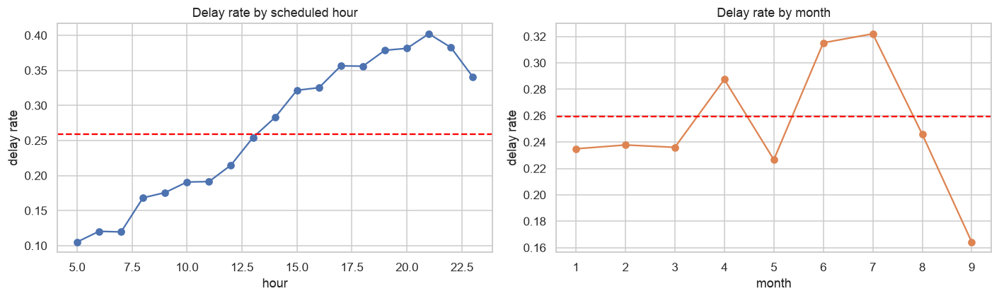
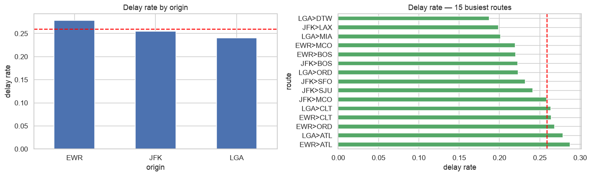
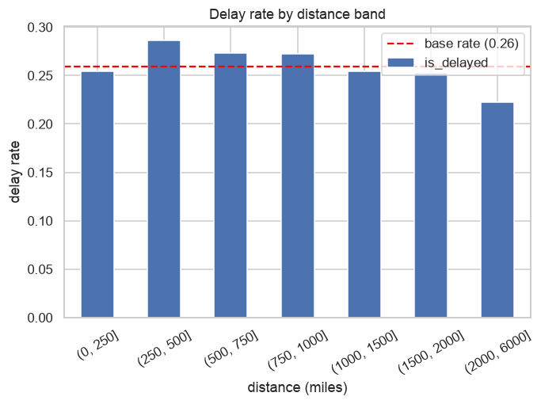
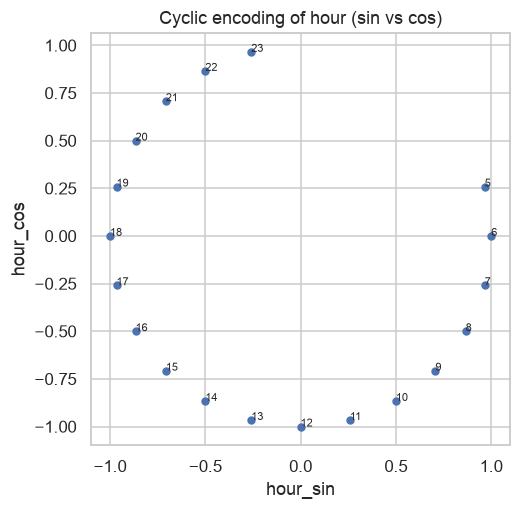
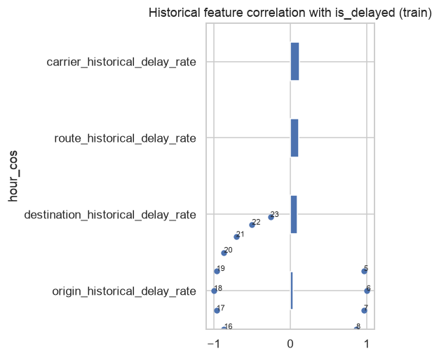

# Flight Delay Prediction

A chronology-aware machine learning system that predicts whether a scheduled
flight will arrive substantially late, using schedule information and
prior-date history subject to the availability assumptions documented below.

<div align="center">

**Project 21 — Advanced Machine Learning & Deep Learning**

Team ID `T022` &nbsp;·&nbsp; Section `C`

<!-- 
 -->
<!--  -->
<!--  -->

</div>

---

## Table of Contents

- [Overview](#overview)
- [Problem Definition](#problem-definition)
- [System Architecture](#system-architecture)
- [Feature Engineering](#feature-engineering)
- [Exploratory Data Analysis](#exploratory-data-analysis)
- [Results Summary](#results-summary)
- [Rescheduling What-If Analysis](#rescheduling-what-if-analysis)
- [Repository Structure](#repository-structure)
- [Getting Started](#getting-started)
- [Reproducing the Full Pipeline](#reproducing-the-full-pipeline)
- [Documentation Index](#documentation-index)
- [Reports and Generated Artifacts](#reports-and-generated-artifacts)
- [Testing](#testing)
- [Team](#team)
- [Roadmap](#roadmap)

---

## Overview

Flight delays are expensive and disruptive, and most operational value comes
from knowing about a likely delay *before* the aircraft leaves the gate. This
project builds a predictive pipeline targeting the scheduled-departure decision
point. Direct post-departure columns are excluded. Historical aggregates use prior calendar dates, but their
exact outcome availability before each prediction remains unverified; see
[the historical protocol](docs/historical_features.md).

The work is delivered in two phases:

| Phase | Focus | State |
|-------|-------|-------|
| **Advanced ML** | Leakage-safe data pipeline, feature engineering, classical classifiers, calibrated evaluation and offline rescheduling what-if | Complete |
| **Deep Learning** | Learned entity embeddings and temporal modelling, benchmarked against the Advanced ML baseline | In Planning |

---

## Problem Definition

| Aspect | Specification |
|--------|---------------|
| **Task** | Binary classification |
| **Target** | `is_delayed` — arrival delay ≥ 15 minutes |
| **Prediction time** | Before scheduled departure |
| **Excluded signals** | Actual departure time, departure delay, arrival time, air time, arrival delay |
| **Validation** | Chronological split (no future leaks into the past) |
| **Primary metrics** | PR-AUC and ROC-AUC, supported by precision and recall |

The target is defined in [`target.py`](src/flight_delay/features/target.py);
rows with an undefined arrival outcome are dropped rather than imputed.

---

## System Architecture

The data pipeline is a single, ordered path from raw records to three
chronologically separated datasets. Date ordering is enforced; this alone does
not establish outcome availability at the actual prediction time.



> The pipeline, Logistic Regression, tuned XGBoost, calibration and evaluation
> are implemented. The diagram colors group stages; they do not indicate completion.

The orchestration lives in
[`pipeline.py`](src/flight_delay/data/pipeline.py), and the chronological
split — partitioned by unique calendar date, not by row — is in
[`split.py`](src/flight_delay/data/split.py).

---

## Feature Engineering

All features are derived strictly from the schedule and from historical
outcomes on prior calendar dates (**33 model features** in total). Four
independent engines contribute features, each documented and unit-tested.

### Temporal features &nbsp;·&nbsp; [`temporal.py`](src/flight_delay/features/temporal.py)

| Feature | Description |
|---------|-------------|
| `day_of_week` | Weekday index, 0 = Monday |
| `is_weekend` | Saturday or Sunday indicator |
| `season` | Meteorological season, 1–4 |
| `hour_sin`, `hour_cos` | Cyclic encoding of the scheduled hour |
| `month_sin`, `month_cos` | Cyclic encoding of the month |
| `day_of_week_sin`, `day_of_week_cos` | Cyclic encoding of the weekday |

Cyclic encodings keep neighbouring values close in feature space, so that
hour 23 sits next to hour 0 rather than at the opposite extreme.

### Route features &nbsp;·&nbsp; [`route.py`](src/flight_delay/features/route.py)

| Feature | Description |
|---------|-------------|
| `route` | `origin>dest` identifier, e.g. `JFK>MIA` |
| `distance_band` | Binned flight distance |
| `is_long_haul` | Distance ≥ 1500 miles |
| `distance_log` | `log1p` of distance, compressing the long tail |

These describe the route itself and are fixed regardless of outcome, so they
introduce no leakage.

### Historical delay features &nbsp;·&nbsp; [`historical.py`](src/flight_delay/features/historical.py)

Historical delay statistics computed from **previous calendar dates only** —
same-day observations are deliberately excluded via a shifted cumulative
aggregation.

| Entity | Features |
|--------|----------|
| Carrier | `carrier_historical_delay_rate`, `carrier_historical_flight_count` |
| Origin | `origin_historical_delay_rate`, `origin_historical_flight_count` |
| Destination | `destination_historical_delay_rate`, `destination_historical_flight_count` |
| Route | `route_historical_delay_rate`, `route_historical_flight_count` |

### Airport congestion features &nbsp;·&nbsp; [`congestion.py`](src/flight_delay/features/congestion.py)

Schedule-derived airport load (known before departure, so no leakage):

| Feature | Description |
|---------|-------------|
| `origin_hourly_departures` | Flights scheduled to depart the same origin in the same (date, hour) |
| `dest_hourly_arrivals` | Flights scheduled to arrive at the same destination in the same (date, arrival hour) |

These represent "airport congestion" directly (time-specific scheduled load). On
this single-hub, one-year dataset their marginal value is small — the scheduled
hour already captures most time-of-day congestion — but they satisfy the brief's
congestion requirement and would matter more on a larger multi-airport dataset.

### Feature selection &nbsp;·&nbsp; [`selection.py`](src/flight_delay/features/selection.py)

A single guard separates model inputs from the target and removes every
post-departure, outcome, or identifier column before training, enforcing the
pre-departure contract in code.

Supporting documentation: [data dictionary](docs/data_dictionary.md),
[feature policy](docs/feature_policy.md),
[historical features](docs/historical_features.md),
[feature analysis](docs/feature_analysis.md),
[data contract](docs/data_contract.md).

---

## Exploratory Data Analysis

The full analysis is in
[`notebooks/01_data_exploration.ipynb`](notebooks/01_data_exploration.ipynb).
Selected findings:

<table>
  <tr>
    <td width="50%" valign="top">
      
      <p align="center"><sub><b>Target base rate</b> — class balance of delayed vs. on-time arrivals.</sub></p>
    </td>
    <td width="50%" valign="top">
      
      <p align="center"><sub><b>Delay rate by carrier</b> — operator-level variation in delay propensity.</sub></p>
    </td>
  </tr>
  <tr>
    <td width="50%" valign="top">
      
      <p align="center"><sub><b>Delay rate by scheduled hour and month</b> — strong time-of-day and seasonal structure.</sub></p>
    </td>
    <td width="50%" valign="top">
      
      <p align="center"><sub><b>Delay rate by origin and top routes</b> — motivating the historical route features.</sub></p>
    </td>
  </tr>
  <tr>
    <td width="50%" valign="top">
      
      <p align="center"><sub><b>Distance versus delay</b> — basis for distance banding and long-haul flagging.</sub></p>
    </td>
    <td width="50%" valign="top">
      
      <p align="center"><sub><b>Cyclic hour encoding</b> — sanity check that hour 23 and hour 0 are adjacent.</sub></p>
    </td>
  </tr>
</table>

<div align="center">
  
  <p><sub><b>Historical feature correlation</b> — Prior-date historical rates correlate with the target; correlation alone does not establish predictive utility or availability-time safety.</sub></p>
</div>

---

## Results Summary

Two classifiers are trained and compared under the frozen chronological
protocol: a class-balanced Logistic Regression and a tuned XGBoost. Both are
calibrated on a held-out late-training window (isotonic selected by validation
Brier), with operating thresholds frozen on validation before the one-time test.
Full methodology, calibration study, paired uncertainty intervals and a
proper-score audit are in [evaluation_results.md](docs/evaluation_results.md) and
[evaluation_audit.md](docs/evaluation_audit.md).

**Validation (development set, 50,466 flights, delay prevalence 0.156)**

| Model | Threshold | PR-AUC | ROC-AUC | Precision | Recall | F1 | Brier |
|-------|----------:|-------:|--------:|----------:|-------:|---:|------:|
| Balanced Logistic Regression | 0.345 | 0.230 | 0.638 | 0.229 | 0.576 | 0.327 | 0.152 |
| Tuned XGBoost | 0.257 | 0.212 | 0.626 | 0.216 | 0.596 | 0.317 | 0.137 |

**Held-out test (one-time frozen evaluation, 48,581 flights, prevalence 0.269)**

| Model | PR-AUC | ROC-AUC | Precision | Recall | F1 |
|-------|-------:|--------:|----------:|-------:|---:|
| Balanced Logistic Regression | 0.296 | 0.545 | 0.300 | 0.465 | 0.364 |
| Tuned XGBoost | 0.338 | 0.599 | 0.332 | 0.542 | 0.412 |

XGBoost is the stronger descriptive held-out candidate on PR-AUC, ROC-AUC,
precision, recall and F1. Discrimination is modest in absolute terms (ROC-AUC
≈ 0.60), and the evaluation audit shows the calibrated probabilities are not
convincingly better than a prevalence baseline on proper scores. No
production-readiness claim is made; prevalence differs between validation and
test, so their metrics are not directly comparable.

---

## Rescheduling What-If Analysis

The second half of the project's expected deliverable: an **offline, assumption-
explicit** analysis of whether the calibrated probabilities can drive a proactive
rescheduling rule. Full method, assumptions and limitations are in
[rescheduling_analysis.md](docs/rescheduling_analysis.md); the logic lives in
[`rescheduling.py`](src/flight_delay/evaluation/rescheduling.py) and runs via
[`scripts/rescheduling_analysis.py`](scripts/rescheduling_analysis.py).

Given per-flight costs — `C_d` for an unmitigated delay, `C_a` for taking an
action, and recovery `r` for the share of delay cost avoided when acting on a
true delay — the net saving versus doing nothing has a closed form,

```
net_savings = tp · (r·C_d − C_a) − fp · C_a
```

and the **cost-optimal action threshold is `τ* = C_a / (r·C_d)`**. The decision
boundary is therefore read directly off the cost assumptions, which is precisely
why calibration matters operationally.

Because no real intervention cost is approved, results are a sensitivity sweep
over the cost ratio `C_a/C_d` (recovery fixed at 0.8), run on the validation
partition so the held-out test is preserved:

| `C_a/C_d` | `τ*` | Balanced LR — beats no-action? | Tuned XGBoost — beats no-action? |
|----------:|-----:|:------------------------------:|:--------------------------------:|
| 0.05 | 0.063 | ✓ (+0.075/flt) | ✓ (+0.075/flt) |
| 0.10 | 0.125 | ✓ (+0.025/flt) | ✓ (+0.034/flt) |
| 0.15 | 0.188 | ✗ (−0.016/flt) | ✓ (+0.005/flt) |
| 0.25 | 0.313 | ✗ (−0.049/flt) | ✗ (−0.020/flt) |

**Findings.** A model-driven rescheduling rule pays off only when interventions
are cheap relative to a delay — up to `C_a/C_d ≈ 0.10` for Logistic Regression
and `≈ 0.15` for XGBoost. Under moderate costs, neither model beats doing nothing,
because low precision makes false-alarm costs dominate. **XGBoost has the more
favourable cost-sensitivity profile across the meaningful range** (wider
contiguous positive-savings region, higher oracle efficiency), with one isolated
degenerate exception at the highest cost ratios where both models act on almost
nothing — a decision-relevant reason to prefer XGBoost that the ranking metrics
alone did not surface.

---

## Repository Structure

```text
flight-delay-prediction/
├── configs/            Pipeline and model configuration (config.yaml)
├── data/
│   ├── raw/            Source dataset (flights.csv)
│   ├── interim/        Intermediate artifacts (ignored)
│   └── processed/      Model-ready datasets (ignored)
├── docs/               Data contract, dictionaries, feature/eval/rescheduling reports
├── models/             Saved model artifacts (ignored)
├── notebooks/          EDA, logistic regression, XGBoost, evaluation
├── reports/
│   ├── figures/        EDA visualizations
│   ├── results/        Model comparison outputs (ignored)
│   └── evaluation/     Calibrated predictions, metrics, rescheduling (ignored, regenerable)
├── scripts/            compare_models, audit, calibration, rescheduling_analysis CLIs
├── src/flight_delay/
│   ├── data/           load, target, split, pipeline, audit, prepare
│   ├── features/       temporal, route, historical, selection, target, model_features
│   ├── models/         logistic, xgboost_model
│   └── evaluation/     metrics, calibration, thresholds, predictions, evaluate,
│                       rescheduling, baselines, run_state, plots
└── tests/              Automated test suite (223 tests)
```

---

## Getting Started

**Requirements:** Python 3.11 or newer.

```bash
# Create and activate a virtual environment
python -m venv .venv
source .venv/bin/activate

# Install the package in editable mode with all dependencies
pip install -e .
```

Build the chronological datasets:

```python
from flight_delay.data.pipeline import build_data_pipeline

train, validation, test = build_data_pipeline("data/raw/flights.csv")
```

Configuration — target threshold, split ratios, random seed, and model
settings — is centralized in [`configs/config.yaml`](configs/config.yaml).

---

## Reproducing the Full Pipeline

The complete Advanced ML phase runs end to end from the raw dataset. Run from the
repository root with the package installed.

> **Reproducibility note.** CI runs only the synthetic tests (it never reads the
> real dataset or the held-out test partition). The data-dependent steps below were
> verified to run on the real `data/raw/flights.csv`: `scripts/compare_models.py`
> reproduces the documented balanced-LR validation AP of `0.206047` exactly. To
> check changes, re-run steps 1–3; **do not** re-run the guarded final-test stage
> just to verify edits — it is intended to run once.

```bash
# 1. Model-to-model comparison on the chronological validation split
python scripts/compare_models.py --n-jobs 4

# 2. Frozen evaluation — refit early-training bases, calibrate on late training,
#    freeze calibration + thresholds on validation (writes reports/evaluation/)
python -m flight_delay.evaluation.evaluate validation \
  --data data/raw/flights.csv --output-dir reports/evaluation --n-jobs 4

# 3. Offline rescheduling what-if over the selected calibrated predictions
python scripts/rescheduling_analysis.py --eval-dir reports/evaluation \
  --cost-ratio 0.25 --recovery 0.8

# 3b. Concrete sample prediction (demo): raw score -> isotonic calibration ->
#     frozen threshold -> decision, for real validation flights
python scripts/predict_example.py

# 4. One-time held-out test — only after reviewing reports/evaluation/selection.json
python -m flight_delay.evaluation.evaluate final-test \
  --data data/raw/flights.csv --output-dir reports/evaluation
```

> The final-test stage is guarded by persistent exclusive markers: a started test
> phase cannot be silently retried. Do **not** rerun the real final test merely to
> check implementation changes. On macOS, XGBoost needs OpenMP (`brew install
> libomp`). The supplementary calibration and audit commands are listed under
> [Evaluation and supplementary audits](#evaluation-and-supplementary-audits).

---

## Documentation Index

| Document | Contents |
|----------|----------|
| [data_contract.md](docs/data_contract.md) | Prediction-time contract and excluded post-departure fields |
| [data_dictionary.md](docs/data_dictionary.md) | Every raw and engineered column |
| [feature_policy.md](docs/feature_policy.md) | Rules separating model inputs from the target |
| [feature_analysis.md](docs/feature_analysis.md) | Feature-level findings and rationale |
| [historical_features.md](docs/historical_features.md) | Prior-date historical protocol and availability caveat |
| [xgboost_methodology.md](docs/xgboost_methodology.md) | XGBoost training and tuning protocol |
| [xgboost_results.md](docs/xgboost_results.md) | Selected hyperparameters and validation results |
| [model_comparison.md](docs/model_comparison.md) | Logistic Regression vs XGBoost comparison |
| [evaluation_results.md](docs/evaluation_results.md) | Calibration, thresholds, paired uncertainty, held-out test |
| [evaluation_audit.md](docs/evaluation_audit.md) | Reproduction, proper-score audit and remaining limitations |
| [rescheduling_analysis.md](docs/rescheduling_analysis.md) | Offline rescheduling what-if, assumptions and sensitivity |

---

## Reports and Generated Artifacts

All data, model and evaluation artifacts are regenerable and Git-ignored
(see [`.gitignore`](.gitignore)); only the committed EDA figures and the
documentation above are tracked.

| Location | Produced by | Contents |
|----------|-------------|----------|
| `reports/figures/*.png` | `notebooks/01_data_exploration.ipynb` | Committed EDA visualizations |
| `reports/results/` | `scripts/compare_models.py` | Validation model-comparison CSV |
| `reports/evaluation/*.csv` | `evaluate validation` / `final-test` | Aligned predictions and operating curves |
| `reports/evaluation/*.json` | `evaluate` | Metrics, bootstrap, and frozen `selection.json` provenance |
| `reports/evaluation/figures/` | `evaluate` | ROC, PR, reliability, confusion and proper-score plots |
| `reports/evaluation/frozen.joblib` | `evaluate validation` | Frozen bases, calibrators and thresholds |
| `reports/evaluation/rescheduling/` | `scripts/rescheduling_analysis.py` | What-if JSON reports, cost-ratio sweep, net-benefit curves and figures |

The raw dataset is expected at `data/raw/flights.csv` (the Kaggle 2013 US flights
starter dataset); it is the only tracked file under `data/`.

---

## Testing

The suite covers data loading, target construction, the chronological split,
every feature engine, and the feature-selection guard, with particular
attention to leakage prevention in the historical features.

```bash
pytest
```

The full local suite includes seven tests that read `data/raw/flights.csv`.
CI uses Python 3.12 and runs synthetic fixtures only:

```bash
python -m pytest -q --ignore=tests/test_load.py --ignore=tests/test_pipeline.py --ignore=tests/test_prepare.py
```

No CI job trains on the real dataset or evaluates the real final-test partition.
See [the evaluation audit](docs/evaluation_audit.md) for actual execution results,
versions and remaining limitations.

---

## Team

| Member | Role |
|--------|------|
| Samiksha Jangid (2401010410) | Team Lead — Data Pipeline and Leakage Prevention |
| Rashmi Anand (2401010374)| Exploratory Data Analysis and Feature Engineering |
| Ankit Raj Singh (2401010075)| Logistic Regression |
| Shubhaang Kataruka (2401010450) | XGBoost and Hyperparameter Tuning |
| Lakshya (2401020036)| Evaluation and Calibration |

---


---

## Dataset

The project uses the recommended Kaggle US flight dataset as the starter dataset:
**[Flights — Kaggle (2013 US flights)](https://www.kaggle.com/datasets/matinsajadi/flights)**
(the 2013 NYC-origin `nycflights13` records). Download `flights.csv` and place it
at `data/raw/flights.csv`.

**Dataset at a glance:** 336,776 raw rows × 21 columns → **327,346 usable** after
dropping 9,430 rows with an undefined arrival outcome (0 duplicates); 16 carriers,
3 origin airports (EWR/JFK/LGA), 105 destinations, 224 routes, year 2013.

**Delay prevalence shifts across the chronological partitions** (a real seasonal
effect, not a bug): train **25.9%**, validation **15.6%**, test **26.9%**. Because
precision–recall metrics depend on prevalence, cross-partition comparisons are not
read as improvements. See the partition/monthly figure in the report
(`paper/figures/prevalence-shift.png`).

## Evaluation and supplementary audits

The original full-training model comparison and the later early-training
calibration study use different fitted estimators. Their validation results and
frozen held-out test scores are documented separately in
[the original evaluation report](docs/evaluation_results.md).

```bash
python scripts/audit_evaluation.py --data data/raw/flights.csv --output-dir reports/evaluation
python scripts/verify_frozen_predictions.py --data data/raw/flights.csv --output-dir reports/evaluation --partition validation --sample-size 100
python -m scripts.analyze_calibration_baselines --data data/raw/flights.csv --output-dir reports/evaluation
```

The auditor and baseline commands create uniquely named JSON reports. The frozen
validation verifier is read-only and prints its findings without writing files.
All three preserve existing artifacts. The baseline analysis fits constants on base-training or late-training
calibration labels only; it never reads test metrics. On macOS, XGBoost needs
OpenMP (`brew install libomp`); the documented local environment uses
`DYLD_LIBRARY_PATH="$PWD/.venv/libomp"` as an alternative.

A separate reproduction exactly matched the published frozen experiment on the
same dataset and package versions. This establishes reproducibility for that
environment, not production readiness or proof of historical label availability.
See [audit methodology, evidence and reproduction commands](docs/evaluation_audit.md).

Saved prediction CSVs should be loaded with
`flight_delay.evaluation.predictions.load_prediction_csv`: it preserves string
IDs and exact floating-point probabilities, validates the schema, and does not
round the frozen threshold. Evaluation phases now use persistent exclusive start
markers and staged, non-overwriting publication. Failed attempts retain evidence
and cannot be automatically retried. See the hardening and recovery section of
[the audit documentation](docs/evaluation_audit.md); do not rerun the real final
test merely to check implementation changes.
