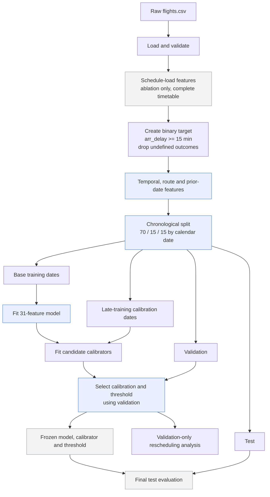
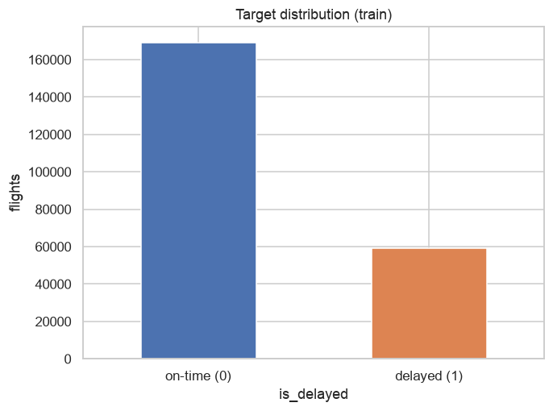
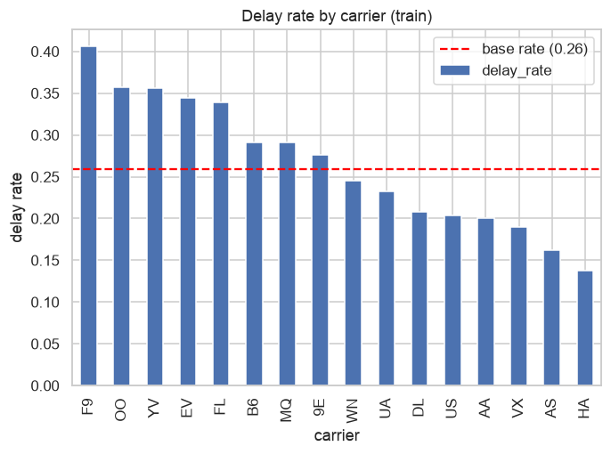
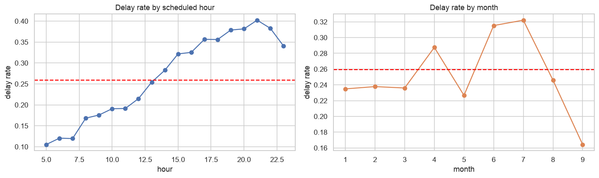
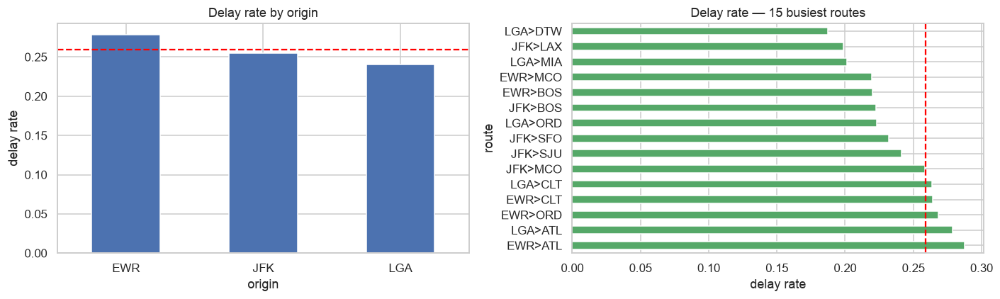
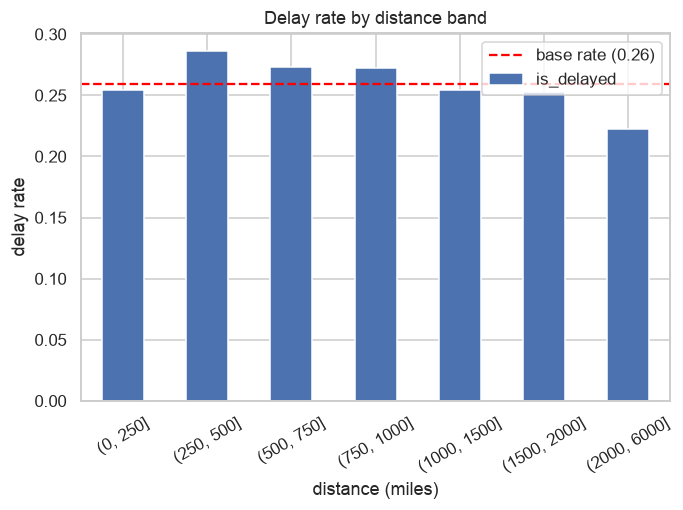
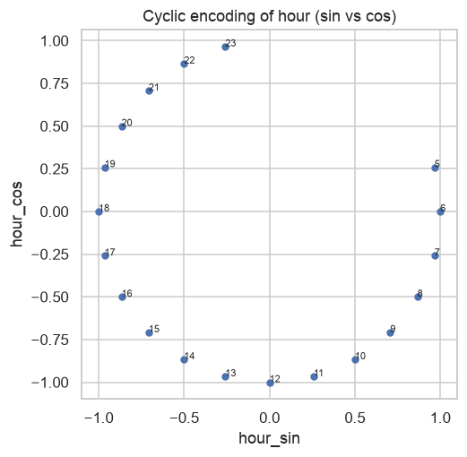
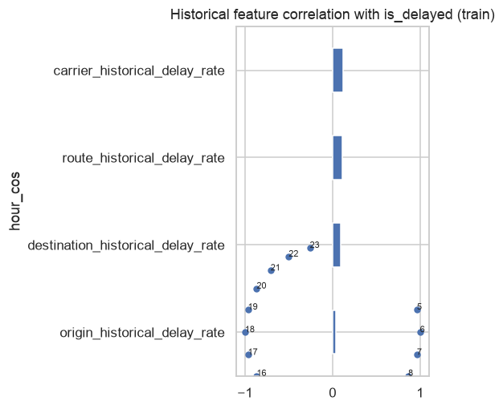
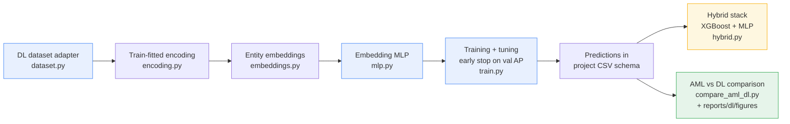

# Flight Delay Prediction

A chronology-aware machine learning system that predicts whether a scheduled
flight will arrive substantially late, using schedule information and
prior-date history subject to the availability assumptions documented below.

<div align="center">

**Project 21 — Advanced Machine Learning & Deep Learning**

Team ID `T022` &nbsp;·&nbsp; Section `C`


</div>

---

## Table of Contents

- [Overview](#overview)
- [Problem Definition](#problem-definition)
- [System Architecture](#system-architecture)
- [Project Workflow — What We Did, Stage by Stage](#project-workflow--what-we-did-stage-by-stage)
- [Feature Engineering](#feature-engineering)
- [Exploratory Data Analysis](#exploratory-data-analysis)
- [Results Summary](#results-summary)
- [Deep Learning Extension (Phase 2)](#deep-learning-extension-phase-2)
- [Rescheduling What-If Analysis](#rescheduling-what-if-analysis)
- [Repository Structure](#repository-structure)
- [Getting Started](#getting-started)
- [Reproducing the Full Pipeline](#reproducing-the-full-pipeline)
- [Documentation Index](#documentation-index)
- [Reports and Generated Artifacts](#reports-and-generated-artifacts)
- [Testing](#testing)
- [Team](#team)
- [Dataset](#dataset)
- [Evaluation and supplementary audits](#evaluation-and-supplementary-audits)

---

## Overview

Flight delays are expensive and disruptive, and most operational value comes
from knowing about a likely delay *before* the aircraft leaves the gate. This
project builds a predictive pipeline targeting the scheduled-departure decision
point. Direct post-departure columns are excluded. Historical aggregates use prior calendar dates, but their
exact outcome availability before each prediction remains unverified; see
[the historical protocol](docs/historical_features.md).

The work is delivered in two phases:

| Phase | Focus | State |
|-------|-------|-------|
| **Advanced ML** | Leakage-safe data pipeline, feature engineering, classical classifiers, calibrated evaluation and offline rescheduling what-if | Complete |
| **Deep Learning** | Embedding MLP (learned airline/airport embeddings) reusing the same partitions and pre-departure contract, plus a leakage-safe ML+DL hybrid, a DL ablation study and the AML-vs-DL comparison | Complete — AML, MLP and hybrid compared on chronological validation |

---

## Problem Definition

| Aspect | Specification |
|--------|---------------|
| **Task** | Binary classification |
| **Target** | `is_delayed` — arrival delay ≥ 15 minutes |
| **Prediction time** | Before scheduled departure |
| **Excluded signals** | Actual departure time, departure delay, arrival time, air time, arrival delay |
| **Validation** | Chronological split (no future leaks into the past) |
| **Primary metrics** | Average Precision (AP) and ROC-AUC, supported by precision and recall |

The target is defined in [`target.py`](src/flight_delay/features/target.py);
rows with an undefined arrival outcome are dropped rather than imputed.

---

## System Architecture

The data pipeline is a single, ordered path from raw records to three
chronologically separated datasets. Date ordering is enforced; this alone does
not establish outcome availability at the actual prediction time.



> The gray schedule-load step is a validation-only feature ablation; its counts
> use the **complete schedule before** undefined-outcome rows are dropped. The
> canonical model uses 31 features without these congestion columns. Historical
> features use **prior calendar dates only**. Calibration is fitted on a
> late-training window, selected with validation, and the test split is used
> only after choices are frozen. The diagram colors group stages; they do not
> indicate completion.

The orchestration lives in
[`pipeline.py`](src/flight_delay/data/pipeline.py), and the chronological
split — partitioned by unique calendar date, not by row — is in
[`split.py`](src/flight_delay/data/split.py).

---

## Project Workflow — What We Did, Stage by Stage

The full journey from raw data to a cost-based decision rule. Each stage lists
what we did, where the code lives, and where the written result is.

| # | Stage | What we did | Code | Write-up |
|---|-------|-------------|------|----------|
| 1 | **Data loading & cleaning** | Loaded 336,776 raw 2013 NYC-origin flights; validated the schema; dropped 9,430 rows with an undefined arrival outcome (no imputation) → **327,346 usable** rows. | [`load.py`](src/flight_delay/data/load.py), [`target.py`](src/flight_delay/features/target.py) | [data_contract.md](docs/data_contract.md), [data_dictionary.md](docs/data_dictionary.md) |
| 2 | **Exploratory data analysis** | On the **training partition only**, quantified the drivers of delay: time-of-day (~10.5% → ~40%), season, carrier, origin and route spread, and the flat distance profile. Produced the committed EDA figures. | [`01_data_exploration.ipynb`](notebooks/01_data_exploration.ipynb) | [feature_analysis.md](docs/feature_analysis.md) + figures below |
| 3 | **Feature engineering** | Built four leakage-safe engines: cyclic temporal, static route, prior-date historical aggregates, and schedule-based congestion proxies. Enforced a pre-departure allowlist. **31-feature** canonical set; **33-feature** congestion variant. | [`features/`](src/flight_delay/features/) | [feature_policy.md](docs/feature_policy.md), [historical_features.md](docs/historical_features.md) |
| 4 | **Chronological split & calibration windows** | Split by **calendar date** 70/15/15; split training again in time into a base-train window (fit models) and a late-training calibration window (fit calibrators). | [`split.py`](src/flight_delay/data/split.py), [`prepare.py`](src/flight_delay/data/prepare.py) | report §Methodology |
| 5 | **Logistic Regression baseline** | Trained class-balanced Logistic Regression on the shared pipeline and feature contract. | [`logistic.py`](src/flight_delay/models/logistic.py), [`03_logistic_regression.ipynb`](notebooks/03_logistic_regression.ipynb) | [model_comparison.md](docs/model_comparison.md) |
| 6 | **XGBoost tuning** | Tuned XGBoost with `RandomizedSearchCV` over expanding, date-grouped, embargoed chronological folds on **training data only** (250 trees, depth 6, lr 0.03, …). | [`xgboost_model.py`](src/flight_delay/models/xgboost_model.py), [`04_xgboost.ipynb`](notebooks/04_xgboost.ipynb) | [xgboost_methodology.md](docs/xgboost_methodology.md), [xgboost_results.md](docs/xgboost_results.md) |
| 7 | **Calibration & threshold selection** | Compared raw / sigmoid / isotonic maps, selecting isotonic by validation Brier; froze one operating threshold per model by validation F1. | [`calibration.py`](src/flight_delay/evaluation/calibration.py), [`thresholds.py`](src/flight_delay/evaluation/thresholds.py) | [evaluation_results.md](docs/evaluation_results.md) |
| 8 | **Frozen held-out evaluation** | Froze estimators, calibrators, thresholds, dataset hash and versions to disk, then ran the guarded one-shot test. Added a paired date-block bootstrap (300 resamples) and a proper-score audit vs a prevalence baseline. | [`evaluate.py`](src/flight_delay/evaluation/evaluate.py), [`baselines.py`](src/flight_delay/evaluation/baselines.py) | [canonical_evaluation.json](docs/canonical_evaluation.json), [evaluation_audit.md](docs/evaluation_audit.md), [`05_model_evaluation.ipynb`](notebooks/05_model_evaluation.ipynb) |
| 9 | **Congestion ablation** | Ran a controlled with/without-congestion comparison on **validation only** (31 vs 33 features); marginal AP change was negligible (≈ ±0.0005). | [`congestion_ablation.py`](scripts/congestion_ablation.py) | [congestion_ablation.json](docs/congestion_ablation.json) |
| 10 | **Decision analysis (rescheduling)** | Derived a closed-form net-benefit and cost-optimal threshold `τ* = C_a/(r·C_d)`; swept the cost ratio on validation to find where acting beats inaction. | [`rescheduling.py`](src/flight_delay/evaluation/rescheduling.py), [`rescheduling_analysis.py`](scripts/rescheduling_analysis.py) | [rescheduling_analysis.md](docs/rescheduling_analysis.md) |
| 11 | **Reproducibility & tests** | Automated tests and CI; dataset SHA-256 and dependency versions recorded in the manifest; final-test stage guarded against silent reruns. | [`tests/`](tests/) | [evaluation_audit.md](docs/evaluation_audit.md) |

The runnable commands for stages 5–10 are in
[Reproducing the Full Pipeline](#reproducing-the-full-pipeline).

---

## Feature Engineering

The canonical frozen model uses **31 features** from the schedule and
prior-date historical aggregates. A separate 33-feature variant adds two
schedule-derived congestion proxies and is evaluated only on validation.
Availability of prior-date outcomes at the exact operational prediction time
has not been verified. Four independent feature engines contribute columns,
each documented and unit-tested.

### Temporal features &nbsp;·&nbsp; [`temporal.py`](src/flight_delay/features/temporal.py)

| Feature | Description |
|---------|-------------|
| `day_of_week` | Weekday index, 0 = Monday |
| `is_weekend` | Saturday or Sunday indicator |
| `season` | Meteorological season, 1–4 |
| `hour_sin`, `hour_cos` | Cyclic encoding of the scheduled hour |
| `month_sin`, `month_cos` | Cyclic encoding of the month |
| `day_of_week_sin`, `day_of_week_cos` | Cyclic encoding of the weekday |

Cyclic encodings keep neighbouring values close in feature space, so that
hour 23 sits next to hour 0 rather than at the opposite extreme.

### Route features &nbsp;·&nbsp; [`route.py`](src/flight_delay/features/route.py)

| Feature | Description |
|---------|-------------|
| `route` | `origin>dest` identifier, e.g. `JFK>MIA` |
| `distance_band` | Binned flight distance |
| `is_long_haul` | Distance ≥ 1500 miles |
| `distance_log` | `log1p` of distance, compressing the long tail |

These describe the route itself and are fixed regardless of outcome, so they
introduce no leakage.

### Historical delay features &nbsp;·&nbsp; [`historical.py`](src/flight_delay/features/historical.py)

Historical delay statistics computed from **previous calendar dates only** —
same-day observations are deliberately excluded via a shifted cumulative
aggregation.

| Entity | Features |
|--------|----------|
| Carrier | `carrier_historical_delay_rate`, `carrier_historical_flight_count` |
| Origin | `origin_historical_delay_rate`, `origin_historical_flight_count` |
| Destination | `destination_historical_delay_rate`, `destination_historical_flight_count` |
| Route | `route_historical_delay_rate`, `route_historical_flight_count` |

### Airport congestion features &nbsp;·&nbsp; [`congestion.py`](src/flight_delay/features/congestion.py)

Schedule-derived airport-load proxies, counted over the complete NYC-origin
timetable before rows with undefined arrival outcomes are dropped:

| Feature | Description |
|---------|-------------|
| `origin_hourly_departures` | NYC-origin flights scheduled to depart the same origin in the same departure-date/hour bucket |
| `dest_hourly_arrivals` | NYC-origin flights scheduled to arrive at the same destination in the scheduled-arrival-hour bucket, grouped by departure date |

These are schedule-based congestion proxies, not counts of every operation at
each airport. Destination arrivals are grouped by the flight's departure date;
scheduled arrivals crossing midnight are not rolled into the following
calendar date. They are known from the timetable before departure, but do not
measure realized congestion.

The canonical frozen model and held-out evaluation use the original 31-feature
allowlist, without these two columns. The 33-feature congestion variant is
reported only in the validation ablation; its test performance has not been
measured.

### Feature selection &nbsp;·&nbsp; [`selection.py`](src/flight_delay/features/selection.py)

A single guard separates model inputs from the target and removes every
post-departure, outcome, or identifier column before training, enforcing the
pre-departure contract in code.

Supporting documentation: [data dictionary](docs/data_dictionary.md),
[feature policy](docs/feature_policy.md),
[historical features](docs/historical_features.md),
[feature analysis](docs/feature_analysis.md),
[data contract](docs/data_contract.md).

---

## Exploratory Data Analysis

The full analysis is in
[`notebooks/01_data_exploration.ipynb`](notebooks/01_data_exploration.ipynb).
Selected findings:

<table>
  <tr>
    <td width="50%" valign="top">
      
      <p align="center"><sub><b>Target base rate</b> — class balance of delayed vs. on-time arrivals.</sub></p>
    </td>
    <td width="50%" valign="top">
      
      <p align="center"><sub><b>Delay rate by carrier</b> — operator-level variation in delay propensity.</sub></p>
    </td>
  </tr>
  <tr>
    <td width="50%" valign="top">
      
      <p align="center"><sub><b>Delay rate by scheduled hour and month</b> — strong time-of-day and seasonal structure.</sub></p>
    </td>
    <td width="50%" valign="top">
      
      <p align="center"><sub><b>Delay rate by origin and top routes</b> — motivating the historical route features.</sub></p>
    </td>
  </tr>
  <tr>
    <td width="50%" valign="top">
      
      <p align="center"><sub><b>Distance versus delay</b> — basis for distance banding and long-haul flagging.</sub></p>
    </td>
    <td width="50%" valign="top">
      
      <p align="center"><sub><b>Cyclic hour encoding</b> — sanity check that hour 23 and hour 0 are adjacent.</sub></p>
    </td>
  </tr>
</table>

<div align="center">
  
  <p><sub><b>Historical feature correlation</b> — Prior-date historical rates correlate with the target; correlation alone does not establish predictive utility or availability-time safety.</sub></p>
</div>

---

## Results Summary

The frozen 31-feature evaluation compares class-balanced Logistic Regression
and tuned XGBoost under a chronological protocol. Both are calibrated on a
held-out late-training window (isotonic selected by validation Brier), with
operating thresholds fixed using validation. The test period was also used in
an earlier pre-congestion evaluation and later reproduced for an audit; it was
not untouched throughout project development. Full methodology, calibration
study, paired uncertainty intervals and a proper-score audit are in
[evaluation_results.md](docs/evaluation_results.md) and
[evaluation_audit.md](docs/evaluation_audit.md).

**Validation (development set, 50,466 flights, delay prevalence 0.156)**

| Model | Threshold | Average Precision (AP) | ROC-AUC | Precision | Recall | F1 | Brier |
|-------|----------:|-------:|--------:|----------:|-------:|---:|------:|
| Balanced Logistic Regression | 0.344 | 0.223 | 0.636 | 0.224 | 0.605 | 0.327 | 0.151 |
| Tuned XGBoost | 0.250 | 0.213 | 0.628 | 0.216 | 0.593 | 0.317 | 0.137 |

**Held-out test (frozen 31-feature evaluation, 48,581 flights, prevalence 0.269)**

| Model | Average Precision (AP) | ROC-AUC | Precision | Recall | F1 |
|-------|-------:|--------:|----------:|-------:|---:|
| Balanced Logistic Regression | 0.294 | 0.544 | 0.296 | 0.488 | 0.369 |
| Tuned XGBoost | 0.337 | 0.599 | 0.335 | 0.532 | 0.411 |

XGBoost is the stronger descriptive held-out candidate on AP, ROC-AUC,
precision, recall and F1. Discrimination is modest in absolute terms (ROC-AUC
≈ 0.60), and the evaluation audit shows the calibrated probabilities are not
convincingly better than a prevalence baseline on proper scores. No
production-readiness claim is made; prevalence differs between validation and
test, so their metrics are not directly comparable. The 33-feature
congestion-enabled variant has validation-only ablation results and no held-out
test score; see [congestion_ablation.json](docs/congestion_ablation.json).

---

## Deep Learning Extension (Phase 2)

Phase 2 adds a compact neural model to test the project's core hypothesis — that
**learned embeddings for airline, origin and destination** can capture
interactions that the hand-engineered route/congestion features miss. It reuses
the **identical** target, chronological partitions (327,346 observations), and
pre-departure feature contract as Phase 1. The held-out **test partition is never
used** for training, early stopping, tuning, or model selection.

### Pipeline



### Components

| Component | What it does | Code | Docs |
|-----------|--------------|------|------|
| **Dataset adapter** | Reuses `build_data_pipeline()`; emits reproducible train / calibration / validation / test tensors from the 31-feature allowlist, preserving flight IDs, dates and labels; audits post-departure/future-outcome exclusion. | [`dataset.py`](src/flight_delay/deep_learning/dataset.py) | [dl_data_contract.md](docs/dl_data_contract.md) |
| **Encoding & embeddings** | Train-fitted vocabularies for carrier/origin/dest with reserved missing (`0`) and unseen (`1`) indices; train-fitted numeric imputation/scaling; row-aligned integer + dense tensors; three `nn.Embedding` tables. | [`encoding.py`](src/flight_delay/deep_learning/encoding.py), [`embeddings.py`](src/flight_delay/deep_learning/embeddings.py) | [dl_architecture.md](docs/dl_architecture.md) |
| **Embedding MLP** | Concatenates the three embeddings with the dense block; configurable dense layers, ReLU and dropout; one delay logit per flight; architecture independent of the training loop. | [`mlp.py`](src/flight_delay/deep_learning/mlp.py) | [dl_architecture.md](docs/dl_architecture.md) |
| **Training & tuning** | PyTorch train/val loops, `BCEWithLogitsLoss` + AdamW, early stopping on validation Average Precision, seed-controlled reproducibility, best-checkpoint + hyperparameter export, predictions in the project CSV schema. | [`train.py`](src/flight_delay/deep_learning/train.py), [`dl_config.yaml`](configs/dl_config.yaml) | [dl_ablation.md](docs/dl_ablation.md) |
| **Hybrid (ML+DL)** | Leakage-safe logistic stack over frozen XGBoost + MLP probabilities, fitted on calibration, evaluated on validation. | [`hybrid.py`](src/flight_delay/deep_learning/hybrid.py), [`build_hybrid.py`](scripts/build_hybrid.py) | [hybrid_approach.md](docs/hybrid_approach.md) |

### Phase 2 validation results

All candidates use the same 50,466 validation flights. The base models fit the
early-training dates. Calibration and the logistic hybrid stack fit the
46,894 late-training flights. These scores describe validation performance.

| Model | Average Precision | Trapezoidal PR AUC | ROC-AUC | Brier |
|---|---:|---:|---:|---:|
| Logistic Regression (isotonic) | 0.2233 | 0.2641 | 0.6360 | 0.150899 |
| XGBoost (isotonic) | 0.2129 | 0.2114 | 0.6279 | 0.137199 |
| Embedding MLP (isotonic) | 0.2082 | 0.2039 | 0.6207 | 0.137476 |
| XGBoost + MLP hybrid | 0.2093 | 0.2092 | 0.6255 | 0.137145 |

The MLP and hybrid had lower ranking scores than the calibrated AML baselines
on this validation window. The hybrid reduced Brier score by about 0.000054
relative to calibrated XGBoost. The XGBoost and MLP residuals had correlation
0.968, consistent with substantial overlap in their errors. See the
[hybrid rationale](docs/hybrid_approach.md) and [evaluation](docs/dl_evaluation.md).

The [comparison metrics](reports/dl/metrics.csv) include precision, recall,
F1 and confusion counts at each model's validation maximum-F1 threshold.
The separate 25% minimum-precision rule was attainable for calibrated
Logistic Regression (5.56% recall), and unattainable for calibrated XGBoost,
calibrated MLP and the hybrid. The
[reliability diagram](reports/dl/figures/reliability.png),
[precision-recall curves](reports/dl/figures/precision_recall.png) and
[ROC curves](reports/dl/figures/roc.png) show the same validation comparison.

### Regularization and pre-departure input checks

The original six-trial search selected the published MLP checkpoint. A
[matched-seed ablation](docs/dl_ablation.md) reruns all six configurations at
three shared seeds. Lowering the learning rate increased validation AP by
0.004759 on average. Increasing dropout to 0.3 increased AP by 0.002135.

The [schedule-and-route-only comparison](reports/dl/schedule_only_metrics.csv)
uses the same flights and excludes all eight outcome-history predictors.
This provides a pre-departure comparison whose input availability follows
from the schedule and route. The 31-feature experiment is reported separately
with its [history availability assumption](docs/historical_features.md).

The calibrated AML model remains the basis for the offline rescheduling
analysis below. Both Phase 2 alternatives are included in the comparison.

---

## Rescheduling What-If Analysis

The second half of the project's expected deliverable: an **offline, assumption-
explicit** analysis of whether the calibrated probabilities can drive a proactive
rescheduling rule. Full method, assumptions and limitations are in
[rescheduling_analysis.md](docs/rescheduling_analysis.md); the logic lives in
[`rescheduling.py`](src/flight_delay/evaluation/rescheduling.py) and runs via
[`scripts/rescheduling_analysis.py`](scripts/rescheduling_analysis.py).

Given per-flight costs — `C_d` for an unmitigated delay, `C_a` for taking an
action, and recovery `r` for the share of delay cost avoided when acting on a
true delay — the net saving versus doing nothing has a closed form,

```
net_savings = tp · (r·C_d − C_a) − fp · C_a
```

and the **cost-optimal action threshold is `τ* = C_a / (r·C_d)`**. The decision
boundary is therefore read directly off the cost assumptions, which is precisely
why calibration matters operationally.

Because no real intervention cost is approved, results are a sensitivity sweep
over the cost ratio `C_a/C_d` (recovery fixed at 0.8), run on the validation
partition so the held-out test is preserved:

| `C_a/C_d` | `τ*` | Balanced LR — beats no-action? | Tuned XGBoost — beats no-action? |
|----------:|-----:|:------------------------------:|:--------------------------------:|
| 0.05 | 0.063 | ✓ (+0.075/flt) | ✓ (+0.075/flt) |
| 0.10 | 0.125 | ✓ (+0.025/flt) | ✓ (+0.034/flt) |
| 0.15 | 0.188 | ✗ (−0.016/flt) | ✓ (+0.005/flt) |
| 0.20 | 0.250 | ✗ (−0.049/flt) | ✗ (−0.012/flt) |
| 0.25 | 0.313 | ✗ (−0.056/flt) | ✗ (−0.018/flt) |
| 0.30 | 0.375 | ✓ (+0.0001/flt, degenerate) | ✗ (−0.021/flt) |

**Findings.** A model-driven rescheduling rule pays off only when interventions
are cheap relative to a delay — up to `C_a/C_d ≈ 0.10` for Logistic Regression
and `≈ 0.15` for XGBoost. Under moderate costs, neither model beats doing nothing,
because low precision makes false-alarm costs dominate. **XGBoost has the more
favourable cost-sensitivity profile across the meaningful range** (wider
contiguous positive-savings region, higher oracle efficiency) — a decision-relevant
reason to prefer XGBoost that the ranking metrics alone did not surface. The single
exception is the degenerate high-cost point `C_a/C_d = 0.30`, where Logistic
Regression shows a negligible positive saving (+0.0001/flt) only because its
calibrated scores rarely clear the high threshold, so it acts on almost no flights;
this is not a meaningful reversal.

---

## Repository Structure

```text
flight-delay-prediction/
├── configs/            Pipeline/model config (config.yaml) and DL config (dl_config.yaml)
├── data/
│   ├── raw/            Source dataset (flights.csv)
│   ├── interim/        Intermediate artifacts (ignored)
│   └── processed/      Model-ready datasets (ignored)
├── docs/               Data contract, dictionaries, feature/eval/rescheduling + DL reports
├── models/             Saved model artifacts (ignored)
├── notebooks/          EDA, logistic regression, XGBoost, evaluation
├── paper/              IEEE-format LaTeX report (main.tex) and figures
├── reports/
│   ├── figures/        EDA visualizations
│   ├── results/        Model comparison outputs (ignored)
│   ├── dl/             DL checkpoint, predictions, tuning, hybrid + comparison artifacts, figures/
│   └── evaluation/     Calibrated predictions, metrics, rescheduling (ignored, regenerable)
├── scripts/            compare_models, compare_aml_dl, audit, calibration, rescheduling_analysis, build_hybrid CLIs
├── src/flight_delay/
│   ├── data/           load, target, split, pipeline, audit, prepare
│   ├── features/       temporal, route, historical, selection, target, model_features
│   ├── models/         logistic, xgboost_model
│   ├── deep_learning/  dataset, encoding, embeddings, mlp, train, hybrid
│   └── evaluation/     metrics, calibration, thresholds, predictions, evaluate,
│                       rescheduling, baselines, run_state, plots
└── tests/              Automated AML and DL test suites
```

---

## Getting Started

**Requirements:** Python 3.11 or newer.

```bash
# Create and activate a virtual environment
python -m venv .venv
source .venv/bin/activate

# Install the package in editable mode with all dependencies
pip install -e .

# For the Phase 2 deep-learning work, also install the optional PyTorch extra
pip install -e ".[dl]"
```

Build the chronological datasets:

```python
from flight_delay.data.pipeline import build_data_pipeline

train, validation, test = build_data_pipeline("data/raw/flights.csv")
```

Configuration — target threshold, split ratios, random seed, and model
settings — is centralized in [`configs/config.yaml`](configs/config.yaml).

---

## Reproducing the Full Pipeline

The complete Advanced ML phase runs end to end from the raw dataset. Run from the
repository root with the package installed.

> **Reproducibility note.** CI runs base and CPU PyTorch tests, including
> the dataset alignment check on the tracked CSV. The data-dependent steps below were
> verified to run on the real `data/raw/flights.csv`: `scripts/compare_models.py`
> reproduces the documented balanced-LR validation AP of `0.206047` exactly. To
> check changes, re-run steps 1–3; **do not** re-run the guarded final-test stage
> just to verify edits. The same calendar test period appeared in an earlier
> pre-congestion experiment and was reproduced during audit; it was not used for
> selection in the frozen run, but was not untouched throughout project history.

```bash
# 1. Model-to-model comparison on the chronological validation split
python scripts/compare_models.py --n-jobs 4

# 2. Frozen evaluation — refit early-training bases, calibrate on late training,
#    freeze calibration + thresholds on validation (writes reports/evaluation/)
python -m flight_delay.evaluation.evaluate validation \
  --data data/raw/flights.csv --output-dir reports/evaluation --n-jobs 4

# 3. Offline rescheduling what-if over the selected calibrated predictions
python scripts/rescheduling_analysis.py --eval-dir reports/evaluation \
  --cost-ratio 0.25 --recovery 0.8

# 3b. Concrete sample prediction (demo): raw score -> isotonic calibration ->
#     frozen threshold -> decision, for real validation flights
python scripts/predict_example.py

# 4. Guarded final-test stage — do not rerun just to verify code or documentation
python -m flight_delay.evaluation.evaluate final-test \
  --data data/raw/flights.csv --output-dir reports/evaluation
```

> The final-test stage is guarded by persistent exclusive markers: a started test
> phase cannot be silently retried in the same output directory. The tracked
> [`docs/canonical_evaluation.json`](docs/canonical_evaluation.json) records the
> canonical frozen 31-feature results; the 33-feature congestion variant has
> validation results only. On macOS, XGBoost needs OpenMP (`brew install
> libomp`). The supplementary calibration and audit commands are listed under
> [Evaluation and supplementary audits](#evaluation-and-supplementary-audits).

### Deep Learning (Phase 2)

Requires the optional PyTorch extra (`pip install -e ".[dl]"`).

```bash
# 1. Train, tune and export the embedding MLP (writes reports/dl/:
#    best_model.pt, best_hyperparameters.yaml, tuning_results.csv,
#    train_calibration_predictions.csv, validation_predictions.csv)
python -m flight_delay.deep_learning.train --config configs/dl_config.yaml

# 2. Generate the Phase 1 frozen artifact for this checkout if it is absent
python -m flight_delay.evaluation.evaluate validation --output-dir reports/evaluation

# 3. Build the XGBoost + MLP hybrid and comparison summary
#    (writes reports/dl/hybrid_validation_predictions.csv, hybrid_comparison.json)
python scripts/build_hybrid.py

# 4. Run the AML-vs-DL evaluation (writes reports/dl/summary.json, metrics.csv,
#    reliability_*.csv and all figures to reports/dl/figures/)
python scripts/compare_aml_dl.py --bootstrap 300

# 5. Verify the checkpoint and reproduce the supplementary controls
python scripts/verify_dl_checkpoint.py
python scripts/run_dl_ablation.py
python -m scripts.compare_schedule_only
```

Base models fit early training. Calibrators and the hybrid fit late training.
Hyperparameter selection and the Phase 2 comparison use validation.

---

## Documentation Index

| Document | Contents |
|----------|----------|
| [data_contract.md](docs/data_contract.md) | Prediction-time contract and excluded post-departure fields |
| [data_dictionary.md](docs/data_dictionary.md) | Every raw and engineered column |
| [feature_policy.md](docs/feature_policy.md) | Rules separating model inputs from the target |
| [feature_analysis.md](docs/feature_analysis.md) | Feature-level findings and rationale |
| [historical_features.md](docs/historical_features.md) | Prior-date historical protocol and availability caveat |
| [xgboost_methodology.md](docs/xgboost_methodology.md) | XGBoost training and tuning protocol |
| [xgboost_results.md](docs/xgboost_results.md) | Selected hyperparameters and validation results |
| [model_comparison.md](docs/model_comparison.md) | Logistic Regression vs XGBoost comparison |
| [evaluation_results.md](docs/evaluation_results.md) | Calibration, thresholds, paired uncertainty, held-out test |
| [canonical_evaluation.json](docs/canonical_evaluation.json) | Machine-readable frozen 31-feature evaluation and test-history provenance |
| [evaluation_audit.md](docs/evaluation_audit.md) | Reproduction, proper-score audit and remaining limitations |
| [rescheduling_analysis.md](docs/rescheduling_analysis.md) | Offline rescheduling what-if, assumptions and sensitivity |
| [dl_data_contract.md](docs/dl_data_contract.md) | DL dataset adapter, partition provenance and leakage audit |
| [dl_architecture.md](docs/dl_architecture.md) | Embedding MLP architecture, tensor interface and training interface |
| [dl_ablation.md](docs/dl_ablation.md) | DL hyperparameter/regularization ablation study |
| [hybrid_approach.md](docs/hybrid_approach.md) | Leakage-safe ML+DL stacked hybrid, error-diversity analysis and verdict |
| [dl_evaluation.md](docs/dl_evaluation.md) | AML-vs-DL comparison protocol, aligned metrics, recall-at-precision and figures |
| [dl_literature_review.md](docs/dl_literature_review.md) | Deep-learning literature review grounded in the project's findings |

---

## Reports and Generated Artifacts

Generated data, model and evaluation artifacts are Git-ignored
(see [`.gitignore`](.gitignore)); curated EDA/paper figures, source, reports and
documentation are tracked.

| Location | Produced by | Contents |
|----------|-------------|----------|
| `reports/figures/*.png` | `notebooks/01_data_exploration.ipynb` | Committed EDA visualizations |
| `reports/results/` | `scripts/compare_models.py` | Validation model-comparison CSV |
| `reports/evaluation_v1_noCongestion/` | Preserved evaluation audit snapshot | Historical 100-resample bootstrap; not the source for canonical test metrics |
| `reports/evaluation/*.csv` | `evaluate validation` / `final-test` | Aligned predictions and operating curves |
| `reports/evaluation/*.json` | `evaluate` | Local metrics, bootstrap, and frozen `selection.json` provenance; local bootstrap has 100 resamples, canonical 300-resample intervals are in the tracked manifest; no local `test_metrics.json` |
| `reports/evaluation/figures/` | `evaluate` | ROC, PR, reliability, confusion and proper-score plots |
| `reports/evaluation/frozen.joblib` | `evaluate validation` | Frozen bases, calibrators and thresholds |
| `reports/evaluation/rescheduling/` | `scripts/rescheduling_analysis.py` | What-if JSON reports, cost-ratio sweep, net-benefit curves and figures |
| `reports/dl/` | `train.py` / `build_hybrid.py` | MLP checkpoint, best hyperparameters, tuning results, and prediction CSVs |
| `reports/dl/figures/` | `scripts/compare_aml_dl.py` | AML-vs-DL ROC/PR curves, reliability diagrams, AP/Brier bars and confusion matrices |

Canonical frozen metrics and the 300-resample validation uncertainty interval
are in [`docs/canonical_evaluation.json`](docs/canonical_evaluation.json).

The raw dataset is expected at `data/raw/flights.csv` (the Kaggle 2013 US flights
starter dataset); it is the only tracked file under `data/`.

---

## Testing

The suite covers data loading, target construction, the chronological split,
every feature engine, and the feature-selection guard, with particular
attention to leakage prevention in the historical features. The **66
deep-learning tests** add the dataset adapter contract, encoding/embedding
behaviour, MLP forward/backward passes, training reproducibility and early
stopping, the hybrid's leakage/alignment guards, and the AML-vs-DL comparison
(prediction alignment, recall-at-precision, calibration selection).

```bash
pytest
```

The deep-learning tests require the optional PyTorch extra and skip cleanly
without it:

```bash
pip install -e ".[dl]"
pytest tests/test_dl_dataset.py tests/test_dl_encoding.py tests/test_dl_mlp.py \
       tests/test_dl_training.py tests/test_hybrid.py
```

CI (Python 3.12) runs the synthetic fixtures in one job and installs CPU PyTorch
for the deep-learning job:

```bash
python -m pytest -q --ignore=tests/test_load.py --ignore=tests/test_pipeline.py --ignore=tests/test_prepare.py
```

No CI job trains on the real dataset or evaluates the real final-test partition.
See [the evaluation audit](docs/evaluation_audit.md) for actual execution results,
versions and remaining limitations.

---

## Team

| Member | Phase 1 — Advanced ML | Phase 2 — Deep Learning |
|--------|------------------------|--------------------------|
| Samiksha Jangid (2401010410) | Team Lead — Data Pipeline and Leakage Prevention | PyTorch Neural Network (embedding MLP) |
| Rashmi Anand (2401010374) | Exploratory Data Analysis and Feature Engineering | Training & Hyperparameter Optimization |
| Ankit Raj Singh (2401010075) | Logistic Regression | Categorical Encoding & Embeddings |
| Shubhaang Kataruka (2401010450) | XGBoost and Hyperparameter Tuning | Evaluation & AML vs DL Comparison |
| Lakshya (2401020036) | Evaluation and Calibration | Dataset Integration & Leakage Audit |

---


---

## Dataset

The project uses the recommended Kaggle US flight dataset as the starter dataset:
**[Flights — Kaggle (2013 US flights)](https://www.kaggle.com/datasets/matinsajadi/flights)**
(the 2013 NYC-origin `nycflights13` records). Download `flights.csv` and place it
at `data/raw/flights.csv`.

**Dataset at a glance:** 336,776 raw rows × 21 columns → **327,346 usable** after
dropping 9,430 rows with an undefined arrival outcome (0 duplicates); 16 carriers,
3 origin airports (EWR/JFK/LGA), 105 destinations, 224 routes, year 2013.

**Delay prevalence shifts across the chronological partitions** (a real seasonal
effect, not a bug): train **25.9%**, validation **15.6%**, test **26.9%**. Because
precision–recall metrics depend on prevalence, cross-partition comparisons are not
read as improvements. See the partition/monthly figure in the report
(`paper/figures/prevalence-shift.png`).

## Evaluation and supplementary audits

The original full-training model comparison and the later early-training
calibration study use different fitted estimators. Their validation results and
frozen held-out test scores are documented separately in
[the original evaluation report](docs/evaluation_results.md).

```bash
python scripts/audit_evaluation.py --data data/raw/flights.csv --output-dir reports/evaluation
python scripts/verify_frozen_predictions.py --data data/raw/flights.csv --output-dir reports/evaluation --partition validation --sample-size 100
python -m scripts.analyze_calibration_baselines --data data/raw/flights.csv --output-dir reports/evaluation
```

The auditor and baseline commands create uniquely named JSON reports. The frozen
validation verifier is read-only and prints its findings without writing files.
All three preserve existing artifacts. The baseline analysis fits constants on base-training or late-training
calibration labels only; it never reads test metrics. On macOS, XGBoost needs
OpenMP (`brew install libomp`); the documented local environment uses
`DYLD_LIBRARY_PATH="$PWD/.venv/libomp"` as an alternative.

A separate reproduction exactly matched the published frozen experiment on the
same dataset and package versions. This establishes reproducibility for that
environment, not production readiness or proof of historical label availability.
See [audit methodology, evidence and reproduction commands](docs/evaluation_audit.md).

Saved prediction CSVs should be loaded with
`flight_delay.evaluation.predictions.load_prediction_csv`: it preserves string
IDs and exact floating-point probabilities, validates the schema, and does not
round the frozen threshold. Evaluation phases now use persistent exclusive start
markers and staged, non-overwriting publication. Failed attempts retain evidence
and cannot be automatically retried. See the hardening and recovery section of
[the audit documentation](docs/evaluation_audit.md); do not rerun the real final
test merely to check implementation changes.
