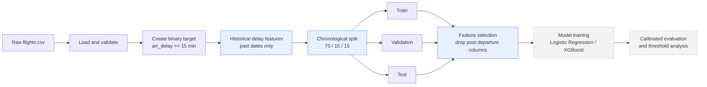

# Flight Delay Prediction

A chronology-aware machine learning system that predicts whether a scheduled
flight will arrive substantially late, using schedule information and
prior-date history subject to the availability assumptions documented below.

<div align="center">

**Project 21 — Advanced Machine Learning & Deep Learning**

Team ID `T022` &nbsp;·&nbsp; Section `C`


</div>

---

## Table of Contents

- [Overview](#overview)
- [Problem Definition](#problem-definition)
- [System Architecture](#system-architecture)
- [Feature Engineering](#feature-engineering)
- [Exploratory Data Analysis](#exploratory-data-analysis)
- [Project Status](#project-status)
- [Repository Structure](#repository-structure)
- [Getting Started](#getting-started)
- [Testing](#testing)
- [Team](#team)
- [Roadmap](#roadmap)

---

## Overview

Flight delays are expensive and disruptive, and most operational value comes
from knowing about a likely delay *before* the aircraft leaves the gate. This
project builds a predictive pipeline targeting the scheduled-departure decision
point. Direct post-departure columns are excluded. Historical aggregates use prior calendar dates, but their
exact outcome availability before each prediction remains unverified; see
[the historical protocol](docs/historical_features.md).

The work is delivered in two phases:

| Phase | Focus | State |
|-------|-------|-------|
| **Advanced ML** | Leakage-safe data pipeline, feature engineering, classical classifiers, calibrated evaluation | In progress |
| **Deep Learning** | Learned entity embeddings and temporal modelling, benchmarked against the Advanced ML baseline | Planned |

---

## Problem Definition

| Aspect | Specification |
|--------|---------------|
| **Task** | Binary classification |
| **Target** | `is_delayed` — arrival delay ≥ 15 minutes |
| **Prediction time** | Before scheduled departure |
| **Excluded signals** | Actual departure time, departure delay, arrival time, air time, arrival delay |
| **Validation** | Chronological split (no future leaks into the past) |
| **Primary metrics** | PR-AUC and ROC-AUC, supported by precision and recall |

The target is defined in [`target.py`](src/flight_delay/features/target.py);
rows with an undefined arrival outcome are dropped rather than imputed.

---

## System Architecture

The data pipeline is a single, ordered path from raw records to three
chronologically separated datasets. Date ordering is enforced; this alone does
not establish outcome availability at the actual prediction time.



> The pipeline, Logistic Regression, tuned XGBoost, calibration and evaluation
> are implemented. The diagram colors group stages; they do not indicate completion.

The orchestration lives in
[`pipeline.py`](src/flight_delay/data/pipeline.py), and the chronological
split — partitioned by unique calendar date, not by row — is in
[`split.py`](src/flight_delay/data/split.py).

---

## Feature Engineering

All features are derived strictly from the schedule and from historical
outcomes on prior calendar dates. Three independent engines contribute
features, each documented and unit-tested.

### Temporal features &nbsp;·&nbsp; [`temporal.py`](src/flight_delay/features/temporal.py)

| Feature | Description |
|---------|-------------|
| `day_of_week` | Weekday index, 0 = Monday |
| `is_weekend` | Saturday or Sunday indicator |
| `season` | Meteorological season, 1–4 |
| `hour_sin`, `hour_cos` | Cyclic encoding of the scheduled hour |
| `month_sin`, `month_cos` | Cyclic encoding of the month |
| `day_of_week_sin`, `day_of_week_cos` | Cyclic encoding of the weekday |

Cyclic encodings keep neighbouring values close in feature space, so that
hour 23 sits next to hour 0 rather than at the opposite extreme.

### Route features &nbsp;·&nbsp; [`route.py`](src/flight_delay/features/route.py)

| Feature | Description |
|---------|-------------|
| `route` | `origin>dest` identifier, e.g. `JFK>MIA` |
| `distance_band` | Binned flight distance |
| `is_long_haul` | Distance ≥ 1500 miles |
| `distance_log` | `log1p` of distance, compressing the long tail |

These describe the route itself and are fixed regardless of outcome, so they
introduce no leakage.

### Historical delay features &nbsp;·&nbsp; [`historical.py`](src/flight_delay/features/historical.py)

Historical delay statistics computed from **previous calendar dates only** —
same-day observations are deliberately excluded via a shifted cumulative
aggregation.

| Entity | Features |
|--------|----------|
| Carrier | `carrier_historical_delay_rate`, `carrier_historical_flight_count` |
| Origin | `origin_historical_delay_rate`, `origin_historical_flight_count` |
| Destination | `destination_historical_delay_rate`, `destination_historical_flight_count` |
| Route | `route_historical_delay_rate`, `route_historical_flight_count` |

### Feature selection &nbsp;·&nbsp; [`selection.py`](src/flight_delay/features/selection.py)

A single guard separates model inputs from the target and removes every
post-departure, outcome, or identifier column before training, enforcing the
pre-departure contract in code.

Supporting documentation: [data dictionary](docs/data_dictionary.md),
[feature policy](docs/feature_policy.md),
[historical features](docs/historical_features.md),
[feature analysis](docs/feature_analysis.md),
[data contract](docs/data_contract.md).

---

## Exploratory Data Analysis

The full analysis is in
[`notebooks/01_data_exploration.ipynb`](notebooks/01_data_exploration.ipynb).
Selected findings:

<table>
  <tr>
    <td width="50%" valign="top">
      
      <p align="center"><sub><b>Target base rate</b> — class balance of delayed vs. on-time arrivals.</sub></p>
    </td>
    <td width="50%" valign="top">
      
      <p align="center"><sub><b>Delay rate by carrier</b> — operator-level variation in delay propensity.</sub></p>
    </td>
  </tr>
  <tr>
    <td width="50%" valign="top">
      
      <p align="center"><sub><b>Delay rate by scheduled hour and month</b> — strong time-of-day and seasonal structure.</sub></p>
    </td>
    <td width="50%" valign="top">
      
      <p align="center"><sub><b>Delay rate by origin and top routes</b> — motivating the historical route features.</sub></p>
    </td>
  </tr>
  <tr>
    <td width="50%" valign="top">
      
      <p align="center"><sub><b>Distance versus delay</b> — basis for distance banding and long-haul flagging.</sub></p>
    </td>
    <td width="50%" valign="top">
      
      <p align="center"><sub><b>Cyclic hour encoding</b> — sanity check that hour 23 and hour 0 are adjacent.</sub></p>
    </td>
  </tr>
</table>

<div align="center">
  
  <p><sub><b>Historical feature correlation</b> — Prior-date historical rates correlate with the target; correlation alone does not establish predictive utility or availability-time safety.</sub></p>
</div>

---

## Repository Structure

```text
flight-delay-prediction/
├── configs/            Pipeline and model configuration (config.yaml)
├── data/
│   ├── raw/            Source dataset
│   ├── interim/        Intermediate artifacts
│   └── processed/      Model-ready datasets
├── docs/               Data contract, feature policy, dictionaries
├── models/             Saved model artifacts (ignored)
├── notebooks/          Exploratory analysis
├── reports/
│   ├── figures/        EDA visualizations
│   └── results/        Evaluation outputs
├── src/flight_delay/
│   ├── data/           load, target, split, pipeline, audit
│   ├── features/       temporal, route, historical, selection
│   ├── models/         Classifier implementations (modelling phase)
│   └── evaluation/     Metrics and calibration (evaluation phase)
└── tests/              Automated test suite
```

---

## Getting Started

**Requirements:** Python 3.11 or newer.

```bash
# Create and activate a virtual environment
python -m venv .venv
source .venv/bin/activate

# Install the package in editable mode with all dependencies
pip install -e .
```

Build the chronological datasets:

```python
from flight_delay.data.pipeline import build_data_pipeline

train, validation, test = build_data_pipeline("data/raw/flights.csv")
```

Configuration — target threshold, split ratios, random seed, and model
settings — is centralized in [`configs/config.yaml`](configs/config.yaml).

---

## Testing

The suite covers data loading, target construction, the chronological split,
every feature engine, and the feature-selection guard, with particular
attention to leakage prevention in the historical features.

```bash
pytest
```

The full local suite includes seven tests that read `data/raw/flights.csv`.
CI uses Python 3.12 and runs synthetic fixtures only:

```bash
python -m pytest -q --ignore=tests/test_load.py --ignore=tests/test_pipeline.py --ignore=tests/test_prepare.py
```

No CI job trains on the real dataset or evaluates the real final-test partition.
See [the evaluation audit](docs/evaluation_audit.md) for actual execution results,
versions and remaining limitations.

---

## Team

| Member | Role |
|--------|------|
| Samiksha Jangid | Team Lead — Data Pipeline and Leakage Prevention |
| Rashmi Anand | Exploratory Data Analysis and Feature Engineering |
| Ankit Raj Singh | Logistic Regression |
| Shubhaang Kataruka | XGBoost and Hyperparameter Tuning |
| Lakshya | Evaluation and Calibration |

---

## Roadmap

**Advanced ML phase**

- [x] Prior-date historical pipeline and chronological validation (availability caveat documented)
- [x] Temporal, route, and historical feature engineering
- [x] Exploratory data analysis
- [x] Automated test suite
- [x] Logistic Regression baseline
- [x] XGBoost classifier with hyperparameter tuning
- [x] PR-AUC, ROC-AUC, precision and recall reporting
- [x] Probability calibration and operational threshold analysis
- [ ] Offline rescheduling impact analysis

**Deep Learning phase**

- [ ] Learned airline embeddings
- [ ] Origin and destination embeddings
- [ ] Temporal sequence modelling
- [ ] Benchmark against the Advanced ML baseline

---

## Dataset

The project uses the recommended Kaggle US flight dataset as the starter
dataset. Acquisition instructions are documented separately; the raw file is
expected at `data/raw/flights.csv`.

## Evaluation and supplementary audits

The original full-training model comparison and the later early-training
calibration study use different fitted estimators. Their validation results and
frozen held-out test scores are documented separately in
[the original evaluation report](docs/evaluation_results.md).

```bash
python scripts/audit_evaluation.py --data data/raw/flights.csv --output-dir reports/evaluation
python -m scripts.analyze_calibration_baselines --data data/raw/flights.csv --output-dir reports/evaluation
```

Both commands create a new uniquely named JSON report and preserve existing
artifacts. The baseline analysis fits constants on base-training or late-training
calibration labels only; it never reads test metrics. On macOS, XGBoost needs
OpenMP (`brew install libomp`); the documented local environment uses
`DYLD_LIBRARY_PATH="$PWD/.venv/libomp"` as an alternative.

A separate reproduction exactly matched the published frozen experiment on the
same dataset and package versions. This establishes reproducibility for that
environment, not production readiness or proof of historical label availability.
See [audit methodology, evidence and reproduction commands](docs/evaluation_audit.md).
